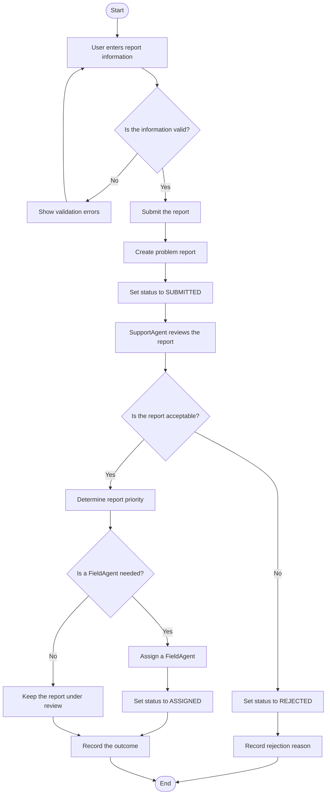
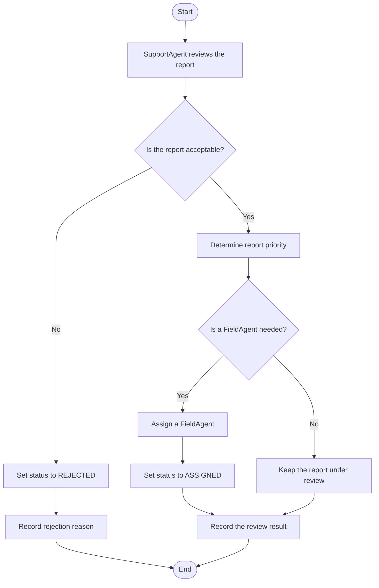
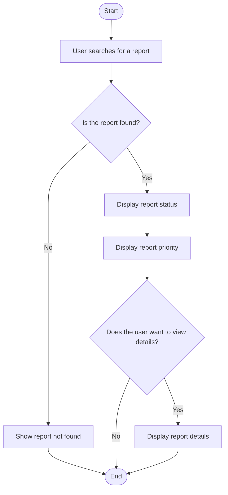
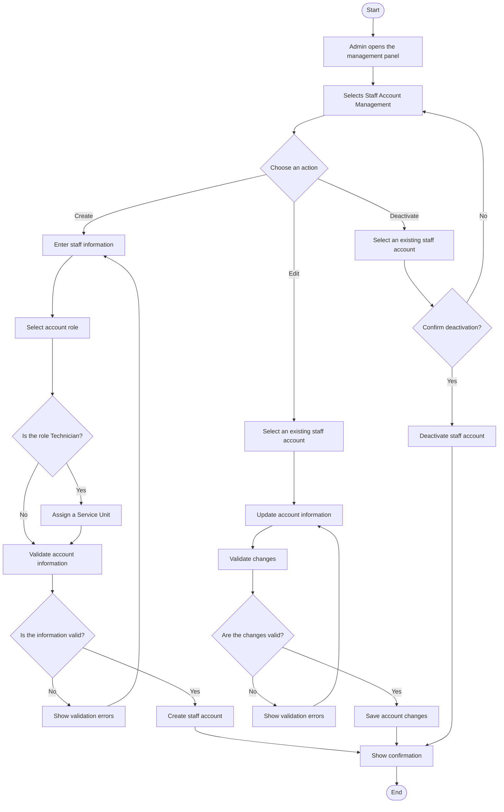

Activity Diagrams — Problem Reporting System

Overview

This document describes the initial activity diagrams for the Problem Reporting System proposed by Team Halolmasayel.

The diagrams represent four main processes: problem reporting, report review and assignment, report status tracking, and Admin account management.

The system includes different roles with specific responsibilities, such as Reporter, Coordinator, Technician, and Admin.

These diagrams represent the initial design of the system and may be revised as the team clarifies the requirements and finalizes the system architecture.

---

1. Problem Reporting and Handling

This diagram shows the process from submitting a problem report to reviewing it, assigning it for investigation, and recording the outcome.

---

2. Report Review and Assignment

This diagram focuses on the SupportAgent's review of a submitted problem, priority determination, and assignment to a FieldAgent when appropriate.

---

3. Problem Status Tracking

This diagram shows how a user searches for a report and views its current status and priority.

---

4. Admin Account Management

This diagram describes how the Admin manages Staff accounts, including creating, editing, and deactivating Coordinator and Technician accounts.

When creating a Technician account, the Admin must also assign the Technician to a Service Unit.

---

Assumptions and Open Questions

These diagrams represent an initial model and may be revised as the team clarifies the system requirements.

- The Reporter account is created automatically through phone number verification using OTP.
- Coordinator and Technician accounts are created and managed by the Admin. Staff members do not register themselves.
- The Admin assigns a Service Unit when creating a Technician account.
- The Coordinator is responsible for reviewing reports and managing their workflow.
- The Technician is responsible for carrying out assigned technical tasks.
- The Admin manages Staff accounts, roles, permissions, and basic system information.
- The Admin does not directly handle problem reports or perform technical tasks.

The following points still need further discussion and agreement within the team:

- Report rejection criteria and priority assignment rules.
- The complete report status lifecycle and the permissions for changing statuses.
- The exact responsibilities of the Coordinator when a new Location or Category is needed.
- The release in which Admin management features will be implemented.
- The authentication and access control process for the Admin.

The diagrams are intended to remain consistent with the project's requirements, Class Diagram, Data Model, and Architecture documentation. Any changes to roles, responsibilities, statuses, or relationships should be reviewed with the team.
