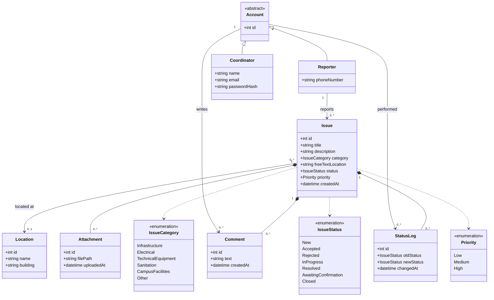

# Abadanesh: Class Diagram (Release 1)

Scope: report and track. Assignment to service units and technicians belongs to Release 2.

## 1. Glossary

| Term | Meaning |
|---|---|
| **Account** | Abstract base for anyone who logs in. |
| **Reporter** | A student or staff member who reports issues and tracks them. Signs in with phone number only (one-time code). |
| **Coordinator** | Reviews reports, updates their status, and follows up until resolution. Signs in with email and password. |

## 2. Class Diagram

## 3. Design Decisions

- **Easy sign-in for reporters:** only a phone number is stored; login uses a one-time code, so there is no password.
- **Stronger credentials for staff:** the Coordinator has a name, email, and password.
- **Separate role classes:** Reporter and Coordinator are distinct classes because their responsibilities differ.
- **Location:** a Reporter may give free text or choose a structured `Location`. The Coordinator must set a structured `Location` when processing an issue.
- **Category:** a fixed enumeration, since it has no attributes of its own.
- **History:** every status change is recorded in `StatusLog`.
- **Attachments:** Reporters can attach photos to an issue.

## 4. Out of Scope for Release 1

- ServiceUnit, Technician, and assigning issues (Release 2)
- Suggestions (Release 3)
- Linking duplicate reports (future)
