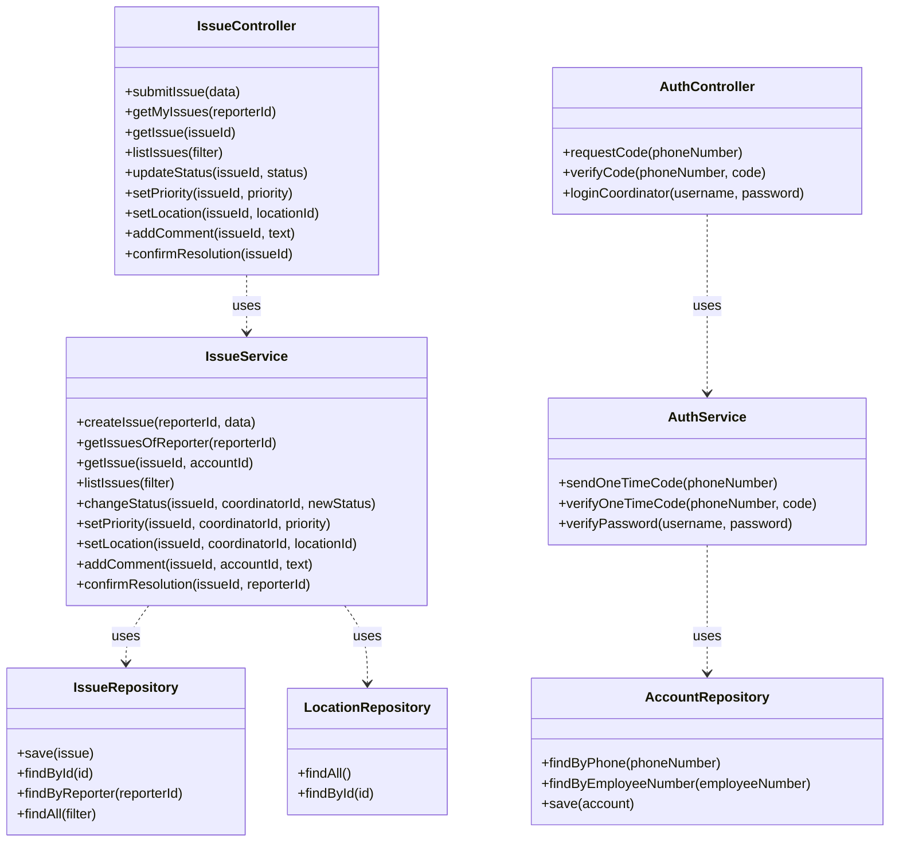
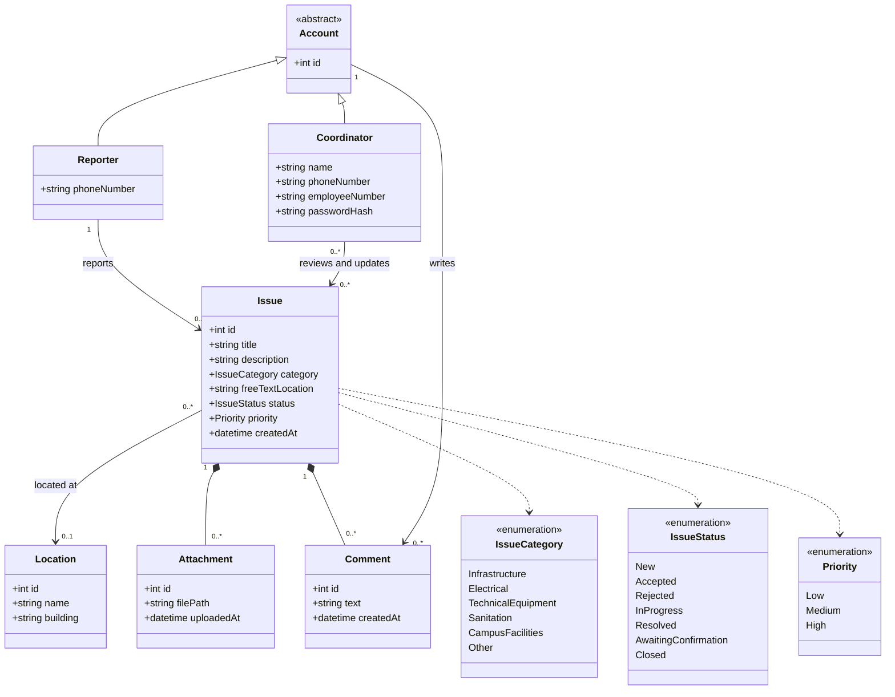

# Abadanesh: Class Diagram (Release 1)

Scope: report and track. Assignment to service units and technicians belongs to Release 2.

## 1. Architecture Context

Abadanesh uses a **layered architecture**. The presentation layer follows **MVC** conventions, and the data access layer uses the **Repository** pattern. The design is **service-based**: entities hold data only, and business rules live in service classes.

| Layer | Classes | Responsibility |
|---|---|---|
| **Presentation** (MVC) | `IssueController`, `AuthController` (Views are screens; see the UI wireframes) | Receive requests from the screens, pass them to a service, return the result or error to the screen. No business rules here. |
| **Business logic** | `IssueService`, `AuthService` | Check the rules (who may do what, which status changes are allowed, required fields) and coordinate the work. |
| **Data access** (Repository) | `IssueRepository`, `AccountRepository`, `LocationRepository` | Save and read data. The only classes that talk to the database. |
| **Entities** (the Model in MVC) | `Account`, `Reporter`, `Coordinator`, `Issue`, `Location`, `Attachment`, `Comment` and the enumerations | Data only. Shared by all layers. |

Rule: each layer only calls the layer directly below it. Controllers never call repositories, and services never talk to the screens.

## 2. Glossary

| Term | Meaning |
|---|---|
| **Account** | Abstract base for anyone who logs in. |
| **Reporter** | A student or staff member who reports issues and tracks them. Signs in with phone number only (one-time code). |
| **Coordinator** | Reviews reports, updates their status, and follows up until resolution. Signs in with a username (phone number or employee number) and password. |
| **Controller** | Presentation-layer class that receives a request from a screen and hands it to a service. |
| **Service** | Business-logic class that enforces the rules of the system. |
| **Repository** | Data-access class that hides how entities are saved and read. |

## 3. Class Diagrams

The design is shown in two diagrams. Diagram A shows the working classes (controllers, services, repositories). Diagram B shows the entities and how they relate.

### 3.1 Diagram A: Layers and Responsibilities

### 3.2 Diagram B: Entities (Model)

## 4. Design Decisions

- **Layered architecture:** one layer for screens, one for rules, one for storage. This answers where the user is served, where rules are checked, and where data is saved.
- **MVC in the presentation layer:** screens are the View, controllers handle requests, and the entities are the Model.
- **Repository pattern:** only repositories know how data is stored, so the rules do not depend on the database or framework chosen later.
- **Service-based design:** entities are plain data. Rules such as "only a Coordinator can change status" live in `IssueService`, not in `Issue`. This keeps the design independent of the framework the team will choose.
- **Controllers stay thin:** they contain no rules. If a rule is needed, it goes in a service.
- **Easy sign-in for reporters:** only a phone number is stored; login uses a one-time code, so there is no password. `AuthService` handles both sign-in methods.
- **Stronger credentials for staff:** the Coordinator has a name, phone number, employee number, and password. The username entered at sign-in can be either the phone number or the employee number (not an email).
- **Unique phone numbers:** a phone number belongs to exactly one account, so the same number cannot be used by both a Reporter and a Coordinator. `AccountRepository.findByPhone` therefore returns at most one account, and `AuthService` checks this rule when an account is created.
- **Separate role classes:** Reporter and Coordinator are distinct classes because their responsibilities differ. `Account` stays as a base class because both roles log in and both can write comments.
- **Location:** a Reporter may give free text or choose a structured `Location`. The Coordinator must set a structured `Location` when processing an issue (`IssueService.setLocation`).
- **Category:** a fixed enumeration, since it has no attributes of its own.
- **Attachments and comments:** they belong to one `Issue` and are saved and loaded together with it through `IssueRepository`, so there is no separate repository for them.

## 5. Tracing a User Story

**Story: a Reporter submits an issue.**

1. The Reporter fills in the report form (View) and presses Submit.
2. `IssueController.submitIssue(data)` receives the request.
3. `IssueService.createIssue(reporterId, data)` checks the rules (title, description and category are present; the category is valid) and creates an `Issue` with status `New`.
4. `IssueRepository.save(issue)` stores the issue (and its attachments).
5. The saved `Issue` is returned through the service to the controller, which sends a success response; the screen then shows "Report submitted."

Data changed: a new `Issue` (status `New`) and its `Attachment` records.

**Error case: the title is empty.** At step 3, `IssueService` rejects the request. Nothing is saved, and the controller returns an error so the form shows "Title is required."

## 6. Out of Scope for Release 1

- ServiceUnit, Technician, and assigning issues (Release 2)
- Suggestions (Release 3)
- Linking duplicate reports (future)
| 2026-11-17 | Added the rule that a phone number cannot belong to both a Reporter and a Coordinator. |
| 2026-11-17 | Clarified step 5 of the user story trace (the saved `Issue` returns through the service to the controller). |
