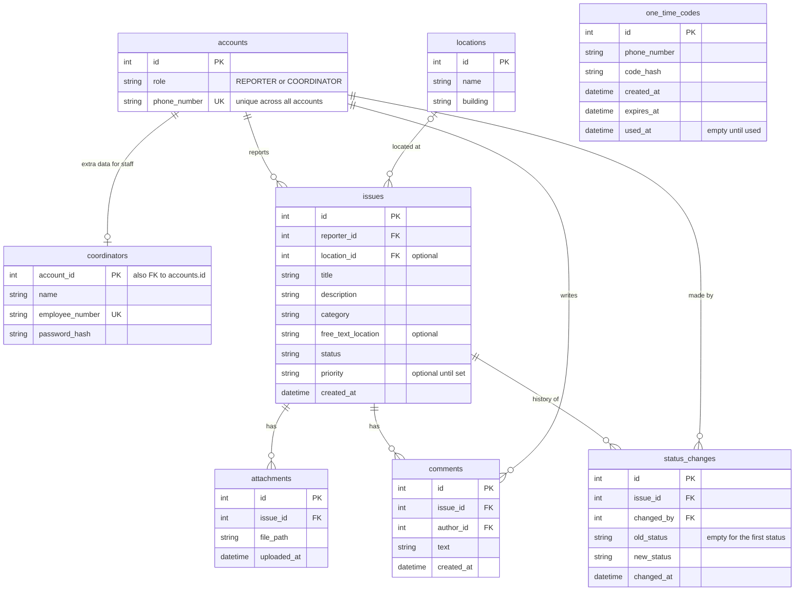

# Abadanesh: Data Model (Release 1)

Scope: report and track. ServiceUnit, Technician, assignment (Release 2) and Suggestions (Release 3) are not stored yet.

This document describes **what information is stored**: entities, fields, identifiers, relationships and constraints. It does not describe code structure; that is the job of the Class Diagram (see section 6 for the differences).

## 1. Entities Overview

| Entity (table) | What it stores |
|---|---|
| `accounts` | Everyone who can log in: one row per Reporter or Coordinator, with the phone number and the role. |
| `coordinators` | The extra data only Coordinators have: name, employee number, password hash. |
| `locations` | The structured list of campus locations an issue can be linked to. |
| `issues` | Reports submitted by Reporters and followed by Coordinators. |
| `attachments` | Photos attached to an issue. |
| `comments` | Messages written on an issue by a Reporter or a Coordinator. |
| `status_changes` | The history of status changes of each issue (who changed it, from what, to what, when). |
| `one_time_codes` | Temporary sign-in codes sent to a phone number. |

A Reporter has no fields beyond the phone number, so a Reporter is simply a row in `accounts` with the role `REPORTER`. It does not need its own table.

## 2. Data Model Diagram

`one_time_codes` has no relationship line on purpose: a code is sent to a phone number that may not belong to any account yet (an unknown number creates a new Reporter account at login).

## 3. Field Details

Legend: **PK** primary key, **FK** foreign key, **UK** unique, **NN** not null.

### 3.1 accounts

| Field | Type | Constraints | Notes |
|---|---|---|---|
| `id` | integer | PK | Generated automatically. |
| `role` | text | NN, one of `REPORTER`, `COORDINATOR` | Decides which sign-in method is used. |
| `phone_number` | text | NN, UK | A phone number belongs to exactly one account. |

### 3.2 coordinators

| Field | Type | Constraints | Notes |
|---|---|---|---|
| `account_id` | integer | PK, FK → `accounts.id` | One coordinator row per account with the role `COORDINATOR`. |
| `name` | text | NN | |
| `employee_number` | text | NN, UK | Can be used as the username at sign-in. |
| `password_hash` | text | NN | Only the hash is stored, never the password. |

### 3.3 locations

| Field | Type | Constraints | Notes |
|---|---|---|---|
| `id` | integer | PK | |
| `name` | text | NN | |
| `building` | text | NN | `name` and `building` together are unique. |

### 3.4 issues

| Field | Type | Constraints | Notes |
|---|---|---|---|
| `id` | integer | PK | |
| `reporter_id` | integer | NN, FK → `accounts.id` | The Reporter who submitted the issue. |
| `location_id` | integer | FK → `locations.id`, may be empty | Empty when the Reporter gave only free text. |
| `title` | text | NN, not blank | |
| `description` | text | NN, not blank | |
| `category` | text | NN, one of `Infrastructure`, `Electrical`, `TechnicalEquipment`, `Sanitation`, `CampusFacilities`, `Other` | Fixed list. |
| `free_text_location` | text | may be empty | What the Reporter typed instead of choosing a location. |
| `status` | text | NN, default `New`, one of `New`, `Accepted`, `Rejected`, `InProgress`, `Resolved`, `AwaitingConfirmation`, `Closed` | Current status only; the history is in `status_changes`. |
| `priority` | text | may be empty, one of `Low`, `Medium`, `High` | Empty until a Coordinator sets it. |
| `created_at` | datetime | NN | Set when the issue is created. |

### 3.5 attachments

| Field | Type | Constraints | Notes |
|---|---|---|---|
| `id` | integer | PK | |
| `issue_id` | integer | NN, FK → `issues.id` | Deleted together with the issue. |
| `file_path` | text | NN | The photo itself is stored as a file; only its path is in the database. |
| `uploaded_at` | datetime | NN | |

### 3.6 comments

| Field | Type | Constraints | Notes |
|---|---|---|---|
| `id` | integer | PK | |
| `issue_id` | integer | NN, FK → `issues.id` | Deleted together with the issue. |
| `author_id` | integer | NN, FK → `accounts.id` | A Reporter or a Coordinator. |
| `text` | text | NN, not blank | |
| `created_at` | datetime | NN | |

### 3.7 status_changes

| Field | Type | Constraints | Notes |
|---|---|---|---|
| `id` | integer | PK | |
| `issue_id` | integer | NN, FK → `issues.id` | |
| `changed_by` | integer | NN, FK → `accounts.id` | The account that made the change. |
| `old_status` | text | may be empty | Empty for the first status of an issue. |
| `new_status` | text | NN | Same allowed values as `issues.status`. |
| `changed_at` | datetime | NN | |

### 3.8 one_time_codes

| Field | Type | Constraints | Notes |
|---|---|---|---|
| `id` | integer | PK | |
| `phone_number` | text | NN | Not a foreign key (see section 2). |
| `code_hash` | text | NN | The code is stored hashed. |
| `created_at` | datetime | NN | |
| `expires_at` | datetime | NN | A code is valid only until this time. |
| `used_at` | datetime | may be empty | Set when the code is used, so it cannot be used twice. |

## 4. Relationships and Rules

| Relationship | Cardinality | Delete behavior |
|---|---|---|
| Account → Coordinator data | 1 to 0..1 | Deleting the account deletes its coordinator row. |
| Account (Reporter) → Issues | 1 to 0..* | An account with issues cannot be deleted. |
| Location → Issues | 0..1 to 0..* | A location in use cannot be deleted. |
| Issue → Attachments | 1 to 0..* | Deleted with the issue. |
| Issue → Comments | 1 to 0..* | Deleted with the issue. |
| Account → Comments | 1 to 0..* | An account with comments cannot be deleted. |
| Issue → Status changes | 1 to 0..* | Deleted with the issue. |
| Account → Status changes | 1 to 0..* | An account with recorded changes cannot be deleted. |

**Rules the database enforces** (always true, whatever the code does):
- `accounts.phone_number` and `coordinators.employee_number` are unique.
- Required fields cannot be empty; `title`, `description` and comment `text` cannot be blank.
- `role`, `category`, `status` and `priority` accept only the listed values.
- Every foreign key must point to an existing row.

**Rules the code enforces** (checked in the services, not by the database):
- Only a Reporter can create an issue, and only a Coordinator can change status, priority or location.
- A Coordinator must set a structured location when processing an issue.
- Only allowed status changes are accepted.
- A new `status_changes` row is added every time `issues.status` changes.
- An unknown phone number creates a new Reporter account at login.

## 5. Tracing a User Story

**Story: a Reporter submits an issue.**

| Step | Data read | Data written |
|---|---|---|
| 1. The Reporter has signed in with a one-time code. | `one_time_codes` (check the code is valid and unused); `accounts` (find the Reporter by phone number) | `one_time_codes.used_at` is set |
| 2. The Reporter fills in the report form and may choose a location. | `locations` (list for the dropdown) | none |
| 3. The Reporter submits the form. | `accounts` (confirm the role is `REPORTER`) | A new `issues` row with status `New`, `created_at` set, and `priority` empty |
| 4. Photos are attached. | none | One `attachments` row per photo |

**Error case: the title is empty.** The service rejects the request before anything is saved, so no row is written. As a second line of defense, the database refuses an empty title even if the code had a bug.

**Second story: a Coordinator accepts an issue.** The system reads the `issues` row and the Coordinator's account, then updates `issues.status` to `Accepted` and adds a `status_changes` row (old status `New`, new status `Accepted`, `changed_by` the Coordinator).

## 6. Data Model vs Class Diagram

| | Class Diagram | Data Model |
|---|---|---|
| Describes | The structure of the code | The information that is stored |
| Contains | Controllers, services, repositories and entities, with methods | Tables, fields, identifiers and constraints |
| Behavior | Methods show what each class does | None; only data and rules about data |

Differences specific to Abadanesh:

- **No code classes:** `IssueController`, `IssueService`, `AuthService`, the repositories and the enumerations do not appear here. Enumerations are stored as text with allowed values.
- **Phone number:** in the class diagram `phoneNumber` is a field of `Reporter` and `Coordinator`; in storage it is one column of `accounts`, so that one unique constraint covers both roles.
- **Inheritance:** `Account`, `Reporter` and `Coordinator` become the tables `accounts` and `coordinators`. A Reporter has no table of its own.
- **Foreign keys:** the class diagram shows an `Issue` that holds its `Attachment` objects; the database stores `issue_id` inside each attachment row.
- **Coordinator and Issue:** the class diagram shows "reviews and updates" as a many-to-many relationship. In storage it becomes the `status_changes` table, which records who changed which issue and when.
- **Storage-only data:** `one_time_codes` and `status_changes` exist for sign-in and history. They are not domain classes in the class diagram.
