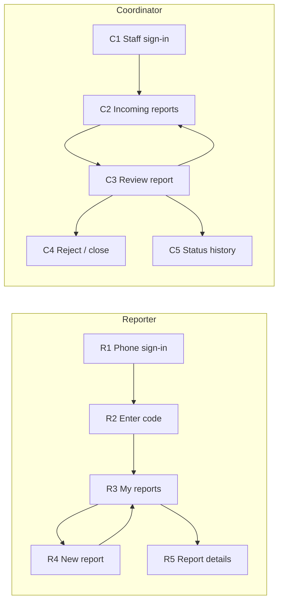

# طرح اولیه رابط کاربری (UI Wireframe) — آبادانش

> پیش‌نویس. فرض: برنامه تحت وب است و روی موبایل هم قابل استفاده است. محدوده: فقط Release 1.
> شماره‌ی User Storyها طبق لیست نهایی تیم است. نقش Admin در این نسخه نیست (مسئولیت سجاد).

هر صفحه سه چیز را نشان می‌دهد: کاربر **چه می‌بیند**، **چه چیزی وارد می‌کند** و **چه پاسخی می‌گیرد**.

## ۱. نقشه‌ی ناوبری



## ۲. صفحه‌های Reporter

### R1 — ورود با شماره‌ی تلفن (US-05)

```
+------------------------------------+
|  Abadanesh                         |
|                                    |
|  Phone number                      |
|  [ 09_________ ]                   |
|                                    |
|  [ Send code ]                     |
+------------------------------------+
```

| می‌بیند | وارد می‌کند | پاسخ |
|---------|-------------|------|
| فرم شماره‌ی تلفن | شماره‌ی تلفن | رفتن به R2 و ارسال کد با SMS |

### R2 — وارد کردن کد OTP (US-05)

```
+------------------------------------+
|  Enter the code sent to 0912...    |
|  [ _ _ _ _ _ ]                     |
|                                    |
|  [ Verify ]      Resend code       |
|                                    |
|  ! Wrong code. Please try again.   |   <- error state
+------------------------------------+
```

| می‌بیند | وارد می‌کند | پاسخ |
|---------|-------------|------|
| فیلد کد | کد OTP | موفق: رفتن به R3 (برای شماره‌ی جدید، حساب خودکار ساخته می‌شود). ناموفق: پیام «Wrong code» |

### R3 — گزارش‌های من (US-02، US-03)

```
+------------------------------------+
|  My Reports              [+ New]   |
|  --------------------------------  |
|  #12  <category> - <location>      |
|       Status: In Progress          |
|  #09  <category> - <location>      |
|       Status: Waiting for          |
|       Confirmation            >    |
+------------------------------------+
```

| می‌بیند | وارد می‌کند | پاسخ |
|---------|-------------|------|
| فهرست گزارش‌های خودش با وضعیت | هیچ | لمس یک گزارش: R5. دکمه‌ی New: R4 |

### R4 — گزارش جدید (US-01، US-06، US-07)

```
+------------------------------------+
|  New Report                        |
|                                    |
|  Category    [ Select        v ]   |
|  Location    (o) Choose from list  |
|              ( ) Type location     |
|              [ Select       v ]    |
|  Description [                  ]  |
|              [                  ]  |
|  Photos      [ + Add photo ]       |
|                                    |
|  [ Submit ]                        |
|                                    |
|  ! Please enter a description.     |   <- error state
+------------------------------------+
```

| می‌بیند | وارد می‌کند | پاسخ |
|---------|-------------|------|
| فرم گزارش | دسته‌بندی، مکان (از فهرست یا متن آزاد)، توضیح، عکس (اختیاری) | موفق: پیام تأیید و رفتن به R3 (گزارش با وضعیت اولیه). خطا: پیام کنار فیلد ناقص |

### R5 — جزئیات گزارش (US-03، US-08)

```
+------------------------------------+
|  Report #09                        |
|  Category: <category>              |
|  Location: <location>              |
|  Status:   Waiting for Confirmation|
|                                    |
|  Description ...                   |
|  Photos  [img] [img]               |
|                                    |
|  [ Confirm resolved ]  [ Reopen ]  |
+------------------------------------+
```

| می‌بیند | وارد می‌کند | پاسخ |
|---------|-------------|------|
| اطلاعات و وضعیت گزارش | انتخاب Confirm یا Reopen | Confirm: وضعیت می‌شود Closed. Reopen: گزارش دوباره باز می‌شود. در هر دو حالت SMS تغییر وضعیت ارسال می‌شود (US-23) |

## ۳. صفحه‌های Coordinator

### C1 — ورود کارکنان (US-11)

```
+------------------------------------+
|  Abadanesh - Staff                 |
|  Username  [ ______________ ]      |
|  Password  [ ______________ ]      |
|  [ Sign in ]                       |
|                                    |
|  ! Invalid credentials.            |   <- error state
+------------------------------------+
```

| می‌بیند | وارد می‌کند | پاسخ |
|---------|-------------|------|
| فرم ورود | مشخصات کارمندی | موفق: C2. ناموفق: پیام خطا و ورود انجام نمی‌شود |

### C2 — گزارش‌های ورودی (US-12)

```
+--------------------------------------------+
|  Incoming Reports                          |
|  Status [All v]  Category [All v]          |
|  Date   [from] - [to]       [ Apply ]      |
|  ----------------------------------------  |
|  #   Category   Location   Status   Date   |
|  15  ...        ...        ...      ...  > |
|  14  ...        ...        ...      ...  > |
|                                            |
|  (no reports match the filters)            |   <- empty state
+--------------------------------------------+
```

| می‌بیند | وارد می‌کند | پاسخ |
|---------|-------------|------|
| جدول گزارش‌ها | فیلتر وضعیت، دسته‌بندی و بازه‌ی تاریخ | جدول فیلترشده. اگر چیزی پیدا نشد پیام «خالی» |

### C3 — بررسی گزارش (US-13، US-14)

```
+--------------------------------------------+
|  Report #15                                |
|  Reporter: 0912****                        |
|  Description ...        Photos [img][img]  |
|  Reporter's location: "near the library"   |
|                                            |
|  Structured location  [ Select        v ]  |
|  Category             [ Select        v ]  |
|  [ Save ]                                  |
|                                            |
|  Status: Under Review                      |
|  Change to [ In Progress          v ]      |
|  [ Update status ]                         |
|                                            |
|  [ Reject / Close... ]  [ View history ]   |
+--------------------------------------------+
```

| می‌بیند | وارد می‌کند | پاسخ |
|---------|-------------|------|
| همه‌ی اطلاعات گزارش | مکان ساختاریافته، دسته‌بندی، وضعیت جدید | Save: ذخیره و پیام تأیید. Update status: وضعیت و تاریخچه ثبت و SMS ارسال می‌شود |

### C4 — رد یا بستن گزارش (US-15)

```
+------------------------------------+
|  Reject / Close report #15         |
|  Reason  [                      ]  |
|  [ Confirm ]   [ Cancel ]          |
|                                    |
|  ! Please enter a reason.          |   <- error state
+------------------------------------+
```

| می‌بیند | وارد می‌کند | پاسخ |
|---------|-------------|------|
| کادر دلیل | دلیل رد یا بستن | ثبت دلیل، تغییر وضعیت، ثبت در تاریخچه، SMS به Reporter |

### C5 — تاریخچه‌ی وضعیت (US-16)

```
+------------------------------------+
|  Status history - Report #15       |
|  Date/time     From -> To          |
|  2026-11-10    Under Review ->     |
|                In Progress         |
|  2026-11-09    (created) ->        |
|                Under Review        |
+------------------------------------+
```

| می‌بیند | وارد می‌کند | پاسخ |
|---------|-------------|------|
| فهرست تغییرها به ترتیب زمان | هیچ | فقط نمایش |

## ۴. دنبال‌کردن یک User Story: US-14 (تغییر وضعیت)

1. Coordinator در C1 وارد می‌شود و C2 را می‌بیند.
2. روی گزارش می‌زند و C3 باز می‌شود.
3. وضعیت جدید «In Progress» را انتخاب و Update status را می‌زند.
4. سیستم وضعیت را ذخیره می‌کند، در تاریخچه ثبت می‌کند و SMS می‌فرستد.
5. Coordinator پیام موفقیت می‌بیند. Reporter در R3 و R5 وضعیت جدید را می‌بیند.

**حالت خطا: ارسال نشدن SMS.** وضعیت و تاریخچه حفظ می‌شوند و Coordinator پیام «Status updated, but the SMS was not sent» را می‌بیند.

## ۵. موارد باز (برای بحث تیم)

- فرض وب بودن برنامه را تأیید کنیم.
- زهرا گفت «هر کاربر یک Reporter است». اگر Coordinator هم می‌تواند گزارش بدهد، به منوی او گزینه‌ی New Report اضافه شود.
- اسم دقیق وضعیت‌ها بین User Storyها و کلاس‌دیاگرام یکی شود.
- صفحه‌های Admin بعد از تصمیم سجاد اضافه شوند.
- اجباری بودن دسته‌بندی در C3 و دلیل در C4 تأیید شود.
