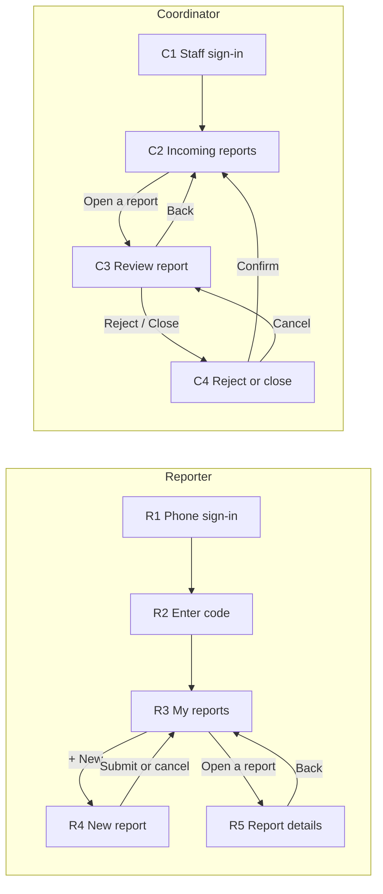

# UI Wireframe: Abadanesh

> Draft. The app is a web application that also works on phones (confirmed by the team).
> Scope: Release 1 only. Admin screens are not included (under discussion).

**How to read this document**

- `Rn` is screen number n in the Reporter flow (R1, R2, ...). `Cn` is screen number n in the Coordinator flow (C1, C2, ...).
- A field marked with `*` is required.
- Each screen shows what the user **sees**, what the user **enters**, and the **response** the user gets.

## 1. Navigation map



Arrows that lead back to an earlier screen (for example R4 to R3) are the return after submitting, cancelling, or going back. They are not separate flows.

## 2. Reporter screens

### R1: Sign in with phone number (US-05)

```
+------------------------------------+
|  Abadanesh                         |
|                                    |
|  Phone number *                    |
|  [ 09_________ ]                   |
|                                    |
|  [ Send code ]                     |
+------------------------------------+
```

| Sees | Enters | Response |
|------|--------|----------|
| Phone number form | Phone number | Goes to R2 and a code is sent by SMS |

### R2: Enter the code (US-05)

```
+------------------------------------+
|  Enter the code sent to 0912...    |
|  Code *                            |
|  [ _ _ _ _ _ ]                     |
|                                    |
|  [ Verify ]      Resend code       |
|                                    |
|  ! Wrong code. Please try again.   |   <- error state
+------------------------------------+
```

| Sees | Enters | Response |
|------|--------|----------|
| Code field | The one-time code (OTP) | Success: goes to R3 (an account is created automatically for a new number). Failure: "Wrong code" message |

### R3: My reports (US-02, US-03)

```
+------------------------------------+
|  My Reports              [+ New]   |
|  --------------------------------  |
|  Broken light in the library       |
|  2026-11-10         In Progress    |
|  --------------------------------  |
|  Water leak in dorm B              |
|  2026-11-08  Waiting for Confirmation
+------------------------------------+
```

| Sees | Enters | Response |
|------|--------|----------|
| The user's own reports, each with title, date, and status | Nothing | Tap a report: R5. Tap "+ New": R4 |

### R4: New report (US-01, US-06, US-07)

```
+------------------------------------+
|  New Report                        |
|                                    |
|  Title *      [                 ]  |
|  Description *[                 ]  |
|               [                 ]  |
|  Category     [ Select        v ]  |
|  Location     (o) Choose from list |
|               ( ) Type location    |
|               [ Select        v ]  |
|  Photos       [ + Add photo ]      |
|                                    |
|  [ Submit ]        [ Cancel ]      |
|                                    |
|  ! Please fill in the required     |   <- error state
|    fields.                         |
+------------------------------------+
```

| Sees | Enters | Response |
|------|--------|----------|
| Report form | Title, description, category, location (from a list or free text), photos (optional) | Success: confirmation message and return to R3 (the report gets its initial status). Error: message next to each missing required field |

### R5: Report details (US-03, US-08)

```
+------------------------------------+
|  Broken light in the library       |
|  Date:     2026-11-10              |
|  Category: <category>              |
|  Location: <location>              |
|  Status:   Waiting for Confirmation|
|                                    |
|  Description ...                   |
|  Photos  [img] [img]               |
|                                    |
|  [ Confirm resolved ]  [ Reopen ]  |
+------------------------------------+
```

| Sees | Enters | Response |
|------|--------|----------|
| Report information and status | Chooses Confirm or Reopen | Confirm: the status becomes Closed. Reopen: the report is opened again. In both cases an SMS about the status change is sent (US-23) |

## 3. Coordinator screens

### C1: Staff sign-in (US-11)

```
+------------------------------------+
|  Abadanesh - Staff                 |
|  Username *                        |
|  [ Phone number or employee ID ]   |
|  Password *                        |
|  [ ______________ ]                |
|  [ Sign in ]                       |
|                                    |
|  ! Invalid credentials.            |   <- error state
+------------------------------------+
```

| Sees | Enters | Response |
|------|--------|----------|
| Sign-in form. The username field says it accepts a phone number or an employee ID | Username and password | Success: goes to C2. Failure: error message and the user stays signed out |

### C2: Incoming reports (US-12)

```
+--------------------------------------------+
|  Incoming Reports                          |
|  Status [All v]   Category [All v]         |
|  Date   [from] - [to]        [ Apply ]     |
|  ----------------------------------------  |
|  Title       Category  Status      Date    |
|  Broken ...  <cat>     Under Rev.  11-10 > |
|  Water ...   <cat>     In Progress 11-08 > |
|                                            |
|  (no reports match the filters)            |   <- empty state
+--------------------------------------------+
```

| Sees | Enters | Response |
|------|--------|----------|
| A table of reports | Filters: status, category, date range (all optional) | A filtered table. If nothing matches, an empty-result message |

### C3: Review a report (US-13, US-14)

```
+--------------------------------------------+
|  Broken light in the library               |
|  Reporter: 0912****     Date: 2026-11-10   |
|  Description ...        Photos [img][img]  |
|  Reporter's location: "near the library"   |
|                                            |
|  Structured location  [ Select        v ]  |
|  Category *           [ Select        v ]  |
|  [ Save ]                                  |
|                                            |
|  Status: Under Review                      |
|  Change to [ In Progress          v ]      |
|  [ Update status ]                         |
|                                            |
|  [ Reject / Close... ]                     |
|                                            |
|  ! Please select a category.               |   <- error state
+--------------------------------------------+
```

| Sees | Enters | Response |
|------|--------|----------|
| All information about the report | Structured location, category, new status | Save: the changes are stored and a confirmation is shown (an error appears if the category is missing). Update status: the status is saved and an SMS is sent to the Reporter |

### C4: Reject or close a report (US-15)

```
+------------------------------------+
|  Reject / Close report             |
|  Reason *                          |
|  [                              ]  |
|  [ Confirm ]   [ Cancel ]          |
|                                    |
|  ! Please enter a reason.          |   <- error state
+------------------------------------+
```

| Sees | Enters | Response |
|------|--------|----------|
| A reason box | The reason for rejecting or closing | The reason is saved, the status changes, and an SMS is sent to the Reporter. Without a reason, an error is shown and nothing changes |

The status history screen is not part of Release 1, so there is no screen for it.

## 4. Following one user story: US-14 (update status)

1. The Coordinator signs in on C1 and sees the list on C2.
2. The Coordinator taps a report and C3 opens.
3. The Coordinator selects the new status "In Progress" and taps "Update status".
4. The system saves the new status and sends an SMS to the Reporter.
5. The Coordinator sees a success message. The Reporter sees the new status on R3 and R5.

**Error case: the SMS cannot be sent.** The new status is still saved, and the Coordinator sees "Status updated, but the SMS was not sent."

## 5. Open questions

- Web app assumption: confirmed by the team.
- Required fields: category (C3) and reason (C4) are confirmed as required. Title and description on R4 are assumptions to confirm.
- "Every user is a Reporter": under discussion. If staff can also report, add "New Report" to the staff menu.
- Status names must match between the user stories and the class diagram (Zahra will comment in the user stories section).
- Admin screens: to be added after Sajad's decision (under discussion).
- US-16 (status history) moves out of Release 1 (confirmed by the team), so this document has no history screen.
